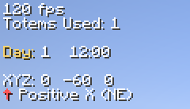
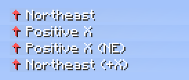
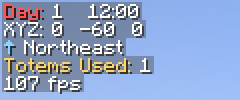
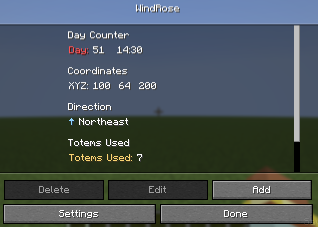
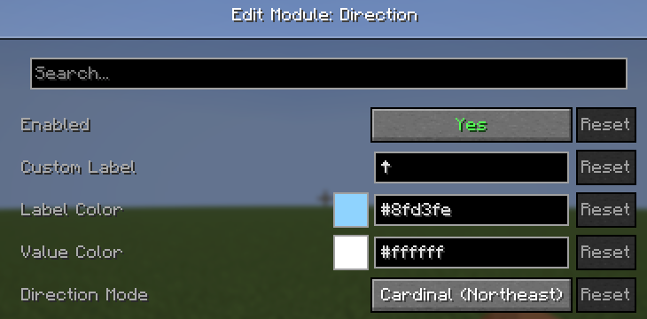
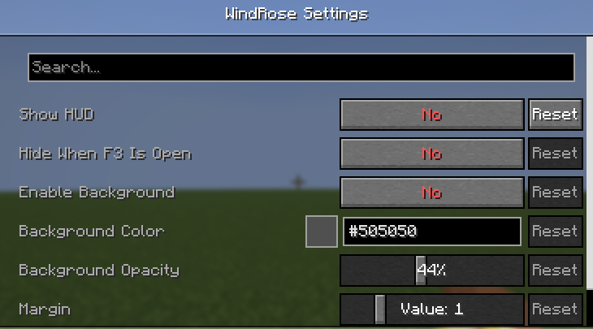

# 🌹 WindRose

**WindRose** adds a clean, fully customizable HUD with the stats you check all the time: the day, your coordinates, the direction you are facing, the totems you have used and your FPS. It keeps the vanilla look, so it fits right in.

It is a lightweight, **client-side** mod: it works in singleplayer and on any server, with nothing to install on the server.

---

## ✨ Features

### 🧭 A HUD with what you need

Pick the modules you want, in the order you want, in the top-left corner of the screen.

 

- **Day Counter**: the current day and, optionally, the time of day.
- **Coordinates**: your block position.
- **Direction**: where you are facing, as a compass direction, an axis, or both.
- **Totems Used**: how many Totems of Undying have saved you, counted per world or server.
- **FPS**: your frame rate.
- **Separator**: an empty line to group the others.

### 🧭 Four ways to show the direction

Use the 8-point compass, the axis you are moving along, or both together.

 

### 🎨 Make it yours

Every module has its own label and colours. Add an optional background with your own colour and opacity, and adjust the margin and line spacing.

 

---

## ⚙️ Configuration

Open the settings from [Mod Menu](https://modrinth.com/mod/modmenu). Add, remove, edit and reorder modules, with a live preview of each one.

 

Each module has its own options: label, colours, and extras such as the direction mode or whether the day counter starts at day 1.

 

In **Settings**:

- **Show HUD**: turn the whole HUD on or off.
- **Hide When F3 Is Open**: hide the HUD while the debug screen is open, since both use the top-left corner.
- **Enable Background**, **Background Color** and **Background Opacity**: a backdrop behind each line.
- **Margin** and **Line Padding**: spacing around the HUD and between lines.

 

---

## 📦 Requirements

- Minecraft **26.3**
- [Fabric Loader](https://fabricmc.net/) and [Fabric API](https://modrinth.com/mod/fabric-api)
- [Mod Menu](https://modrinth.com/mod/modmenu) *(optional, to open the settings)*

Cloth Config is already included.

---

## 📝 Notes

- Totem counts are stored on your computer, so they work on any server and stay with you.
- Found a bug or have an idea? [Open an issue](https://github.com/rodrigograc4/WindRose/issues).
- You are free to add this mod to any modpack.
